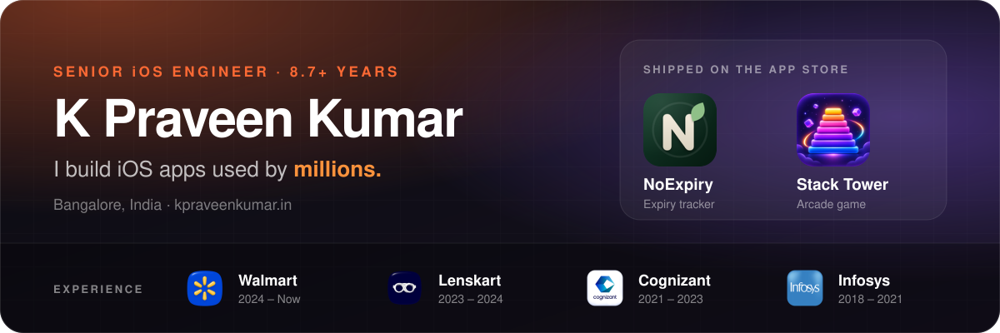

  

 

  &nbsp;
  &nbsp;
  &nbsp;
  

I build fast, stable, well-tested iOS apps with **Swift, SwiftUI, UIKit and Swift Concurrency** — and ship my own apps to the App Store on the side.
 

### Apps I've shipped

<table>
  <tr>
    <td width="50%" valign="top">
       
      
        
      <b>NoExpiry</b>
       
      Scan a label — AI reads the product and its expiry date, then reminds you before it goes to waste.
        
      SwiftUI · Gemini API · Vision OCR · Firebase · StoreKit · WidgetKit
        
      
        
    </td>
    <td width="50%" valign="top">
       
      
        
      <b>Stack Tower</b>
       
      A block-drop arcade game with four game modes, power-ups and physics-based stacking.
        
      SwiftUI · SpriteKit · Game Center
        
      
        
    </td>
  </tr>
</table>
 

### Impact at work
- **~77%** lower Cart memory-leak rate at Walmart
- **60%** fewer app hangs by moving work off the main thread with Swift Concurrency
- **50 MB** smaller app across the Cart, Checkout and PAC modules
- **+25%** customer retention from the Lenskart Product Listing Page revamp

 

### Writing
**[Why @MainActor Doesn't Mean Your Code Runs in the Background →](https://www.linkedin.com/pulse/why-mainactor-doesnt-mean-your-code-runs-background-k-praveen-kumar-rrkxf/)** 
A Swift Concurrency deep dive on actor isolation and where your code actually runs.

  

### Stack

  
  
  
  
  
  
  
  
  
  
  
  

Also: MVVM-C · Clean Architecture · Modularization · Instruments · Crashlytics · WidgetKit · StoreKit

  

  Open to conversations about iOS roles, Swift and app architecture — say hi on <a href="https://www.linkedin.com/in/k-praveen-kumar/">LinkedIn</a>

